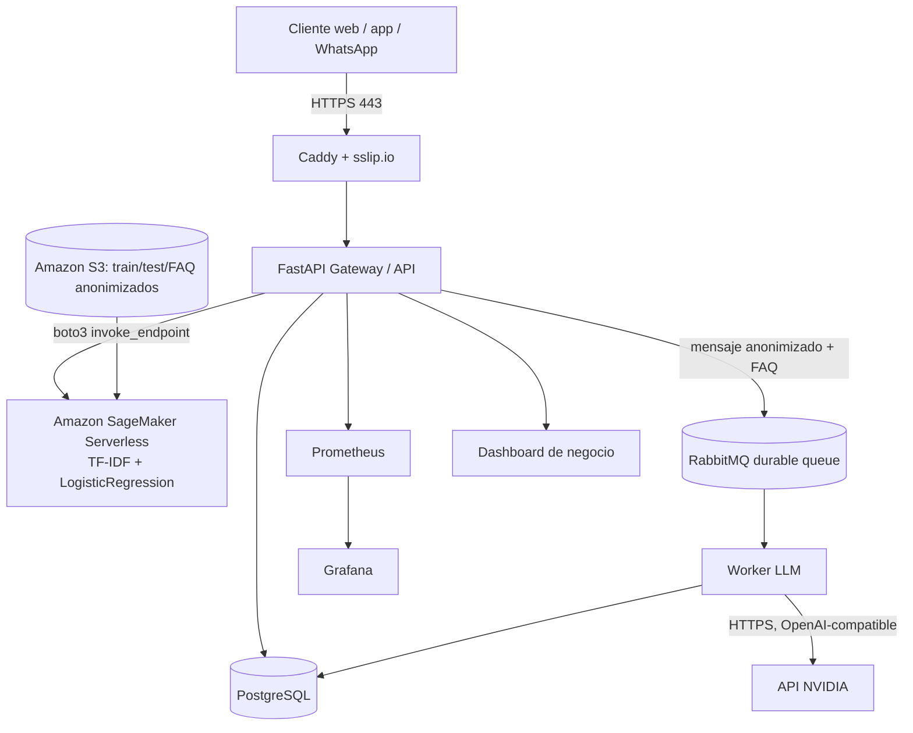

# Arquitectura EP3 · Equipo 1 · Chatbot Telco

## Camino síncrono

1. El cliente envía texto a `/api/predict` o `/api/conversacion` con `X-API-Key`.
2. FastAPI valida el esquema y limita frecuencia.
3. El microservicio de IA invoca el endpoint de SageMaker con el rol EC2 (boto3). No usa access keys.
4. Se obtiene intención, probabilidad y versión del modelo.
5. Se aplican reglas fuera del modelo: solicitud explícita de persona, anulación, molestia y tres clasificaciones fallidas consecutivas.
6. Se guarda la predicción y el mensaje anonimizado.
7. `/api/predict` devuelve clasificación sin llamar al LLM. `/api/conversacion` publica a RabbitMQ y devuelve inmediatamente el ID para consultar el texto después.

## Camino asíncrono y degradación

El worker consume una cola durable, aplica límite de ritmo para respetar el límite de NVIDIA, llama a NVIDIA con timeout y reintentos exponenciales ante 429/errores transitorios, y actualiza PostgreSQL. Si NVIDIA falla, `llm_status=degraded`; la predicción de SageMaker permanece disponible.

## Privacidad y seguridad

La función `app/privacy.py` enmascara RUT, correo, teléfono, tarjetas y expresiones de nombre/dirección antes de persistir y encolar. El worker solo recibe el texto enmascarado y artículos FAQ pertinentes. La autenticación de API usa `X-API-Key`; para consultas de cuenta se exige el token demo configurado en `CUSTOMER_AUTH_TOKEN`. Este token es un mecanismo de demostración, no sustituye integración productiva con SSO/OTP/Siebel. No se devuelven saldos reales en esta EP3.

## Reglas del caso 2

- Intención `anulacion`: derivación a humano, nunca cancelación automática.
- Molestia detectada por reglas de palabras/expresiones: derivación a humano.
- Frase explícita “quiero hablar con una persona”: derivación inmediata.
- Tres mensajes consecutivos con intención bajo umbral: derivación; el contador se mantiene en PostgreSQL por `conversation_id`.
- El historial anonimizado se consulta con `/api/derivaciones/{conversation_id}`.

## Limitaciones que deben declararse

- Detección de molestia y PII basada en reglas; se debe ampliar con NER/DLP y pruebas adversariales antes de producción.
- El historial y el dashboard son mínimos para la EP3; integración Siebel, autenticación real, multi-canal productivo, retención de tres años, CSAT y operación 1.000 sesiones concurrentes requieren hardening adicional.
- El dashboard de negocio está en `/dashboard`; Prometheus/Grafana sirven para observabilidad técnica. No exponer los puertos de Prometheus/Grafana públicamente.
- El objetivo p95 <3 s del LLM debe demostrarse con mediciones cloud. Un timeout no garantiza el objetivo: el equipo debe medirlo.
